 

[](https://scholar.google.com/citations?hl=en&user=weV4dboAAAAJ)
[](https://www.linkedin.com/in/esin-ezgi-yildiz/)
[](mailto:esinezgiyildiz@gmail.com)

## 

Hi! I'm a PhD student in Computer Science at the [University of Milano-Bicocca](https://www.unimib.it/), based in Trento at [Fondazione Bruno Kessler](https://www.fbk.eu/). I work on LLMs for clinical settings, often in Italian.

## 

- Checking LLM answers against their sources
- Getting models to abstain when the evidence is thin
- Combining LLMs with medical ontologies and official tables
- Evaluating these systems with clinicians

## 

**[STRAGMED: Standardizing Retrieval-Augmented Generation Pipelines in Medical Domains](https://link.springer.com/chapter/10.1007/978-3-032-30710-1_15)**  
Leonardo Sanna, Esin Ezgi Yildiz, Mauro Dragoni. *AIME 2026*. [Code](https://github.com/IDA-FBK/STRAGMED--STandardizedRAGMEDical)

A simple RAG pipeline for medical domains, meant as a standard baseline.



## 

- [talk2DergiPark](https://github.com/esineyildiz/talk2dergipark): Chrome extension for chatting with Turkish academic papers
- [PubMedBERT on PubMedQA](https://github.com/esineyildiz/PubMedBERT-fine-tuned-on-PubMedQA): fine-tuning for biomedical question answering
- [morphology-word-embeddings](https://github.com/esineyildiz/morphology-word-embeddings): word embeddings and morphology, from my MSc thesis

## 

```text
2026 - Present  PhD, Computer Science, University of Milano-Bicocca
2022 - 2025     MSc, Cognitive Science, University of Trento
2017 - 2021     BA, Linguistics, Hacettepe University
```

Along the way I collected EEG and eye-tracking data at the [ESOGÜ Cognitive and Behavioral Application Center](https://bildam.esogu.edu.tr/en) and learned MEG and fMRI analysis at [CIMeC](https://www.cimec.unitn.it/en/14/the-center).


